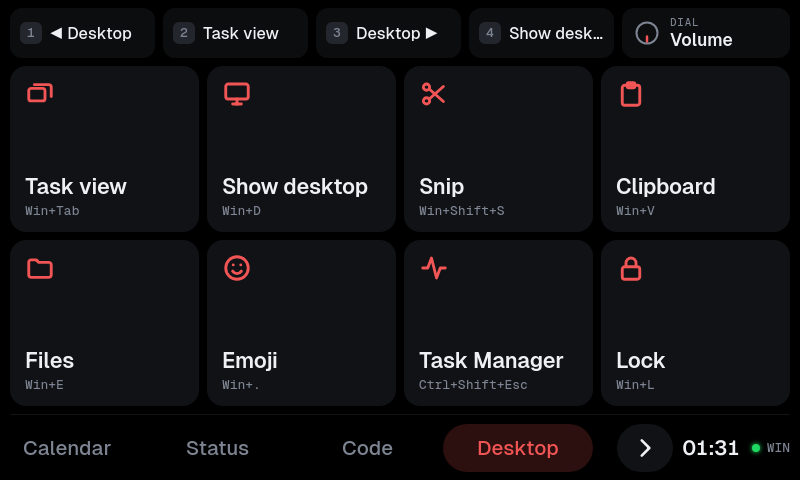

# thingdeck

Turns a Spotify Car Thing into a USB macro pad and media controller, a small
Stream Deck. It needs **no app on the computer**. The computer sees a standard
USB keyboard, media keys and mouse wheel, so it works on Windows, macOS and Linux
as soon as you plug it in.

- **Touchscreen:** pages of large tiles (Desktop, Shell, and a calls page: Discord
  or Meetings), each sending a shortcut, a media key, typed text or a sequence of
  steps, plus live pages filled by the computer agent: Media, Lights (Philips Hue),
  Calendar, Status, Code (GitHub) and Plex. Up to seven tabs share the bottom bar; with more,
  it shows four at a time and scrolls. Settings → Tabs sets their order and hides any
  you don't use. On live pages, the top bar also shows the song playing (tap it for Media).
- **4 top buttons:** presets that change with the page. Tile pages show their
  labels under the buttons; live pages show a big clock and the date there instead,
  and the buttons still work.
- **Dial:** volume, Hue lights (the room you last tapped), scroll, zoom, scrub (arrow keys),
  browser tabs, undo/redo. The menu (M) button switches dial mode.
- **Windows, macOS and Linux:** each tile can have per-OS shortcuts. The pad
  detects Windows by itself; pick macOS or Linux once in Settings (see
  [Host OS](#host-os)).
- **Keyboard layouts:** typed text is translated for the host layout
  (Latin American and US are included).
- **Settings** (the ⚙ tab): brightness (light sensor or manual), host OS, layout,
  dial direction, clock format, calls page (Discord or Meetings), themes and icons,
  tab order, device info, and Reconnect / Restart / Reboot. Settings are saved on
  the Car Thing and survive power cycles.
- **Themes:** Dark, Black, Light, and the editor color schemes Nord, Dracula,
  Catppuccin, Gruvbox, Tokyo Night and Solarized, each with its own accent, one of
  six accent colors, or any hue from a slider. Icons come in three styles (solid,
  outline, emoji) and three colors (neutral, accent, or a color per tile category).
- **Computer agent (optional):** a small background agent on the computer adds what's
  playing with its cover, Philips Hue lights, your calendar with Join buttons, CPU/memory/GPU/network
  graphs, a kill switch for the app in focus, GitHub Actions runs and pull requests,
  the streams and load of your Plex server,
  a volume bar, an audio device picker, a clock and a lock screen (see
  [Computer agent](#computer-agent)).
- **Standby screen** while the computer sleeps; the pad reconnects by itself
  when it wakes up.

Everything runs on the Car Thing itself: a Python service plus a page in its
built-in browser. How it works is in [device/README.md](device/README.md).

## Screenshots

The Car Thing's screen is 800×480. These use made-up demo data.

| | |
|---|---|
|  |  |
| **Media:** what's playing, with controls and the audio output | **Calendar:** the coming week, the next event highlighted |
|  |  |
| **Status:** live stats and the kill switch | **Code:** GitHub Actions runs and your pull requests |
|  |  |
| **Event details:** tap any event | **Audio devices:** tap the output in the Media header |
|  |  |
| **Volume bar:** shows when the volume changes | **Lock screen:** while the computer is locked |
|  |  |
| **Lights:** Philips Hue rooms and zones | **A room:** brightness, white, scenes, each light |
|  |  |
| **Desktop:** a tile page | **Settings → Appearance** |
|  |  |
| **Settings → Tabs:** the tab order | **Plex:** streams, server load and libraries |

## Requirements

- A Car Thing running the stock Spotify system with **ADB enabled** (for example
  the "adb enabled" stock image flashed with `superbird-tool`). It must show up in
  `adb devices`.
- `adb` (Android platform-tools) on the computer you deploy from:

  | OS | Install |
  |---|---|
  | macOS | `brew install android-platform-tools` |
  | Fedora | `sudo dnf install android-tools` |
  | Debian / Ubuntu | `sudo apt install adb` |
  | Windows | `winget install Google.PlatformTools` |

- Bash for `deploy.sh`: the built-in one on macOS and Linux, Git Bash on Windows.

Deploying is the only step that needs `adb`. Once installed, the pad works on any
computer without it.

## Install

```bash
./deploy.sh install
```

This checks the Python files and `config.json` on the Car Thing first (a broken
file is refused and nothing changes), then copies `device/` to `/var/macropad`, adds one file,
`/etc/supervisor.d/macropad.conf`, so the pad starts on boot, and reboots. No
stock file is changed. The file goes on **both** system partitions: the
bootloader keeps two copies of the system (slots A and B) and can switch between
them.

| Command | Does |
|---|---|
| `./deploy.sh` | Push the files and restart the service (after editing code) |
| `./deploy.sh config` | Push only `device/config.json`; the pad reloads it within 2 s |
| `./deploy.sh status` | Show whether the boot hook is on each system slot |
| `./deploy.sh uninstall` | Remove the boot hook and reboot to the stock UI (files stay in `/var/macropad`) |

## Hardware controls

| Control | Default |
|---|---|
| Buttons 1–4 (top edge) | Page presets (media keys on most pages) |
| Dial turn | Current dial mode (Volume, Lights, Scroll, Zoom, Scrub, Tabs, Undo/Redo) |
| Dial press | Dial mode action (mute, middle click, reset zoom, …) |
| Dial hold | Play/Pause |
| Back button | Next page, wrapping from the last back to the first · hold: first page |
| Menu button (M) | Next dial mode · hold: back to Volume |
| Swipe left/right on the page | Change page |
| Bottom bar | Tap a tab (with more than seven, drag the bar or tap › / ‹ for the rest) |
| Song pill (top bar) | Go to Media |
| Tap the status pill (bottom right) | Cycle host OS: Auto → Windows → macOS → Linux |

All of these can be changed in `device/config.json`.

## Host OS

Shortcuts differ per OS, so tiles can carry `"windows"`, `"mac"` and `"linux"`
overrides. The defaults use standard shortcuts: Mission Control and Spotlight on
macOS, GNOME's on Linux.

Over USB, Windows identifies itself, but macOS and Linux look the same. So:

- **Windows:** detected automatically.
- **Linux:** used automatically when the host isn't Windows (`"other_os": "linux"`
  in `config.json`).
- **macOS:** choose **macOS** under Settings → General → Host OS, or by tapping
  the status pill. On a Mac, shortcut hints are shown as ⌃⇧⌥⌘.

The choice is saved on the Car Thing. If you move between a Mac and a Linux
machine, switch it in Settings.

## Calls page

The last tab is either **Discord** (mute, deafen, answer/decline, quick switcher,
back to voice, inbox, mark read) or **Meetings** (Teams, Zoom and Meet mic/camera).
Pick it under Settings → General → Pages → Calls page. **Auto** shows Discord on
Windows and Meetings on macOS and Linux. Discord uses its default shortcuts;
mute and deafen work even when Discord isn't focused.

## Keyboard layout

The pad sends key *positions*, so typed text (the Shell tiles, for example) has
to match the layout the computer uses. Set it under Settings → General → Keyboard
layout:

- **Latin American:** matches Windows "Latin American" and Linux `latam`.
- **US:** use this on a Mac. macOS's own "Latin American" layout puts symbols in
  different places.

Shortcuts made of letters, digits and named keys work with any layout.

## Computer agent

The pad itself is just a USB keyboard, and computers never send track info, the
time or their lock state to a keyboard. An optional agent on the computer sends
them to the Car Thing **over the USB cable** (`adb forward`; no network):

- **Now playing:** the Media page shows the cover, title, artist, album, the app it
  plays in, playing/paused and a live progress bar, with the media controls in a row
  below. When nothing is playing it says so; the controls work either way.
- **Calendar:** the Calendar page shows today, tomorrow and the rest of the week
  from your calendars (see [Adding your calendar](#adding-your-calendar)): repeating
  events, moved or cancelled occurrences and time zones included, meetings you
  declined left out. The next event is highlighted with a countdown. Events with a
  Google Meet, Zoom or Teams link get a Join button that opens the link on the computer.
  Tap an event for its details: date, time and length, place, calendar and notes.
- **Status:** the Status page shows CPU, memory, GPU and network speed, each with
  a graph of the last two minutes. The GPU needs an NVIDIA card (`nvidia-smi`), or
  an AMD one on Linux; CPU temperature shows on Linux.
- **Kill switch:** below the stats, the Status page shows the app that has focus on
  the computer, next to a covered switch like an aircraft's. Tap the cover to lift
  it; once "KILL" lights up (about a second later), press it to force-quit that app.
  The cover closes again after 6 seconds. Only the app shown is killed, and only if
  it still has focus. The system and desktop shell (Explorer, the window manager,
  Finder, the Dock, …) and the agent itself are protected. Finding the focused app:
  - Windows: the foreground window; apps running as administrator can't be killed
    unless the agent runs as administrator too.
  - macOS: the frontmost app (`lsappinfo`, no permission prompts).
  - Linux: X11 (`xprop`), Hyprland, Sway, KDE Wayland with `kdotool`, and GNOME
    Wayland with the [Window Calls](https://extensions.gnome.org/extension/4724/window-calls/)
    extension, since GNOME doesn't share the focused window otherwise.
- **Lights (Philips Hue):** a card per room and zone, tinted with the color its lights
  show, with an on/off switch and a brightness bar (tap or drag). Tap a card for its
  scenes, a warm-to-cool white slider and each light; tapping a room also makes it
  the target of the dial's **Lights** mode (turn: brightness, press: on/off, with a
  bar on screen like the volume one). "All off" turns every room off. See
  [Connecting Philips Hue](#connecting-philips-hue).
- **Code (GitHub):** the latest run of each workflow in one repository (up to 20:
  running, queued, passed, failed or cancelled, with branch, commit and time) and
  your open pull requests on any repository, with their checks, review state and
  draft flag. Both lists scroll. Tap a row to open it in the browser on the computer.
  It refreshes every minute, or every 15 seconds while a workflow runs, and the ↻ button
  on the Actions card fetches it right away (see [Adding GitHub](#adding-github)).
- **Plex:** the streams on your Plex Media Server. Each stream shows its poster, the
  user and player, the progress and the quality. A tag shows how the server sends it:
  direct play, direct stream, or transcode (HW for a hardware transcode). Next to the
  streams are graphs of the server's CPU and bandwidth, and the size of each library,
  with any library scan in progress. The graphs need Plex Pass. The page refreshes
  every 3 seconds (see [Connecting Plex](#connecting-plex)).
- **Volume and audio devices:** when the volume or mute changes (the dial, the Mute
  tile, your keyboard), a volume bar shows at the top for a moment. The Media page
  header shows the current output; tap it to pick the output and input devices.
  - Windows: Core Audio, the same switch the Sound settings use (all roles, so calls
    move too).
  - Linux: `pactl` (PipeWire or PulseAudio).
  - macOS: the volume always; switching devices needs `brew install switchaudio-osx`.
- **Clock:** the agent sets the Car Thing's clock and time zone (DST included).
  The time shows large with the date at the top of the live pages (Media, Lights,
  Calendar, Status, Code, Plex), and on the standby and lock
  screens; 24h/12h is under Settings → General → Clock.
- **Lock screen:** while the computer is locked, the Car Thing shows the clock,
  "🔒 Computer locked", the cover and what's playing, and media buttons. Tiles,
  presets and dial modes that press keys are blocked while locked, so nothing gets
  typed into the password box; media keys, volume and the wheel still work.

Install it once per computer (and once per OS on a dual-boot PC). It starts at
login, survives unplugging and sleep, and needs `adb` (see [Requirements](#requirements)):

| OS | Now playing from | Install |
|---|---|---|
| Windows | The system media session (Spotify, browsers, Media Player, …) | `powershell -ExecutionPolicy Bypass -File host\windows\install.ps1` |
| Linux | MPRIS through `playerctl` (Spotify, browsers, VLC, …) | `host/unix/install.sh` |
| macOS | `nowplaying-cli`, or Spotify and Music through AppleScript | `host/unix/install.sh` |

- **Windows:** a Task Scheduler task at logon starts a tiny windowless launcher
  in `%USERPROFILE%\.thingdeck`. Log: `%USERPROFILE%\.thingdeck\nowplaying.log`.
- **Linux:** a systemd user service (`thingdeck-agent`). Needs `playerctl`
  (`sudo dnf install playerctl`). Log: `journalctl --user -u thingdeck-agent`.
- **macOS:** a LaunchAgent. `brew install nowplaying-cli` is recommended; recent
  macOS versions restrict it, in which case the agent asks Spotify or Music
  directly (macOS asks once to allow that).

Uninstall with `install.ps1 -Uninstall` or `install.sh --uninstall`. To check what
the agent sees without installing: `nowplaying.ps1 -Once` or `nowplaying.py --once`.

### Adding your calendar

The agent reads calendars from their private iCal address, so it needs no sign-in:

1. In Google Calendar on the web, open Settings, pick your calendar under
   "Settings for my calendars", and copy **Secret address in iCal format** from
   "Integrate calendar".
2. Put it on its own line in `calendars.txt` (create the file):
   - Windows: `%USERPROFILE%\.thingdeck\calendars.txt`
   - Linux: `~/.config/thingdeck/calendars.txt`
   - macOS: `~/Library/Application Support/thingdeck/calendars.txt`

   Add one line per calendar. Any iCal address works (Outlook's published calendars
   too); lines starting with `#` are ignored.
3. The agent downloads the calendars every 5 minutes, so they show up within 5
   minutes; no restart needed.

The secret address lets anyone who has it read that calendar, so keep the file to
yourself; if it leaks, reset it on the same Google Calendar settings page. Work
accounts may have it turned off by an administrator.

### Adding GitHub

The agent asks GitHub through the [GitHub CLI](https://cli.github.com), which keeps
your sign-in; no token is stored by thingdeck.

1. Install it and sign in once:
   - Windows: `winget install GitHub.cli`
   - Fedora: `sudo dnf install gh`
   - macOS: `brew install gh`

   Then run `gh auth login`.
2. Put the repository for the Code page in `github.txt`, next to `calendars.txt`:
   its name if it is one of yours (`my-repo`), or `owner/name`. Lines starting with
   `#` are ignored.

The file stays on your computer, so the repository's name is never in this repo.
Your open pull requests come from any repository; the Actions card shows that one.

### Connecting Philips Hue

The Car Thing has no network of its own, so the agent talks to your Hue Bridge on
the local network, using the bridge's own API (no Hue account or cloud involved).

1. Open the **Lights** page and tap **Pair**.
2. Within 30 seconds, press the round button on top of the Hue Bridge.

The agent finds the bridge (through Philips' discovery service), gets a key, and
saves both in `hue.json` next to `calendars.txt`. Your rooms show up a moment later.
To pair again, delete `hue.json` and tap Pair. Light changes made elsewhere (the
Hue app, a switch) show on the Car Thing within about 2 seconds. Lights only work
while the computer is on and the agent is running, and they need a Hue Bridge;
lights used only through Bluetooth can't be reached.

### Connecting Plex

The Car Thing has no network of its own, so the agent reads your Plex Media Server
on the local network. It uses the server's own API, not the Plex cloud.

1. Find the local address of the server. In Plex Web, open Settings → Remote Access.
   The page shows the private address, for example `192.168.1.20:32400`.
2. Put the address on the first line of `plex.txt`, next to `calendars.txt`. If the
   line has no port, the agent uses 32400.
3. If the Plex page shows "The server asks for a Plex token", put your token on the
   second line of `plex.txt`. Plex's article
   [Finding an authentication token](https://support.plex.tv/articles/204059436-finding-an-authentication-token-x-plex-token/)
   shows where to find it.

By default, a Plex server asks for a token, also on the local network. A server
that lists your network under Settings → Network → "List of IP addresses and
networks that are allowed without auth" does not ask for one. The agent reads
`plex.txt` on each refresh, so a change shows within 3 seconds and needs no restart.

The token gives access to your Plex account, so keep `plex.txt` to yourself. The
graphs of CPU and bandwidth need Plex Pass. Without it, the page shows the streams and
libraries only.

## When the computer sleeps

When the computer sleeps or shuts down and the Car Thing still has power, the
screen shows **Computer is asleep**, dims to its minimum brightness, and the
buttons do nothing. Your brightness setting comes back with the computer. When the computer
wakes up, the Car Thing reconnects by itself within a few seconds.

**The Car Thing cannot wake or turn on the computer.** Waking over USB was tried,
and the hardware can't do it. Details are in
[device/README.md](device/README.md#standby-resume-and-reconnect). Use the
computer's own keyboard or power button.

If it ever stays on the standby screen while the computer is on, tap **Reconnect**
at the bottom of that screen (or Settings → Device → Reconnect USB). That
detaches and reattaches USB, like pulling the cable. If the computer still hasn't
picked it up after 20 seconds, the Car Thing reboots.

## Customizing

Edit `device/config.json` and run `./deploy.sh config`. A tile looks like:

```json
{ "label": "Snip", "symbol": "snip", "key": "win+shift+s",
  "mac": { "key": "cmd+shift+4" }, "linux": { "key": "printscreen" } }
```

`symbol` picks a built-in icon that follows the icon style and color settings; an
emoji in `"icon"` works too.

The full action reference (keys, media, typed text, sequences, wheel, page/dial
switching, per-OS overrides) is in [device/README.md](device/README.md#configjson).

## Recovery

- If the service crashes, the USB device falls back to plain ADB, so you can
  always reach the Car Thing again.
- **Safe mode:** hold the back button while the Car Thing boots. The pad then
  leaves USB as ADB only.
- **Stock UI came back by itself?** The bootloader switched system slots. Run
  `./deploy.sh status`, then `./deploy.sh install`.
- `./deploy.sh uninstall` removes the boot hook and restores the stock UI.

## Known limitations

- **Linux overrides assume GNOME** (Fedora Workstation, Ubuntu). On KDE a few
  desktop shortcuts need adjusting.
- **Hue and Plex go through the computer:** with the computer off or asleep, the
  Lights and Plex pages cannot reach the bridge or the server.
- **The live pages, the clock and the lock screen need the agent** on each
  computer. Without it, there's no clock, the Media page shows its controls and a hint, and
  Calendar, Status, Code and Plex say the agent is missing. The macOS and Linux agents are
  untested on real machines so far.
- **No Windows CPU temperature:** Windows only gives it to programs running as
  administrator with a hardware driver, so the Status page leaves it out there.

## License

[PolyForm Noncommercial 1.0.0](LICENSE). In short:

- **Allowed:** using, changing and sharing thingdeck for personal, hobby, research
  or educational use, and by non-profits, schools and public bodies.
- **Not allowed:** any commercial use, or use by a business.
- **Credit:** every copy, changed or not, must include the license and its
  `Required Notice:` line, which credits Leonardo Godoy and links to this repository.

For commercial use, ask the author. Versions published before the license changed
were under GPL-3.0, and those copies keep that license.
