# thingdeck

Turns a Spotify Car Thing into a USB macro pad and media controller, a small
Stream Deck. It needs **no app on the computer**. The computer sees a standard
USB keyboard, media keys and mouse wheel, so it works on Windows, macOS and Linux
as soon as you plug it in.

- **Touchscreen:** live pages filled by the computer agent: Media, Lights (Philips
  Hue), Calendar, Status, Code (GitHub), Plex and NAS (TrueNAS). You can add pages of
  your own large tiles in `config.json`, each sending a shortcut, a media key, typed
  text or a sequence of steps (see [Customizing](#customizing)). Up to seven tabs share the bottom bar;
  with more, it shows four at a time and scrolls. Settings → Tabs sets their order
  and hides any you don't use; live pages you haven't set up (no config file yet)
  start hidden and can be turned on there. On live pages, the top bar also shows the song
  playing (tap it for Media).
- **4 top buttons:** presets, by default first page, page left, page right and last
  page; hold 2 or 3 for the previous or next track (a page can set its own). Live pages
  show a big clock and the date at the top instead of their labels, and the buttons
  still work; a tile page of your own shows the labels.
- **Dial:** volume (on Windows and Linux, per app too: the knob moves it from all to each app),
  Hue lights (the room you last tapped), scroll, zoom, scrub (arrow keys), browser
  tabs, undo/redo. The menu (M) button switches dial mode.
- **Windows, macOS and Linux:** each tile can have per-OS shortcuts. The pad
  detects Windows by itself; pick macOS or Linux once in Settings (see
  [Host OS](#host-os)).
- **Keyboard layouts:** typed text is translated for the host layout
  (Latin American and US are included).
- **Settings** (the ⚙ tab): brightness (light sensor, darker or brighter in stops, or
  manual, and darker at night between two hours), host OS, layout, dial direction,
  clock format, themes and icons,
  tab order and hidden tabs, device info, and Reconnect / Restart / Reboot.
  Settings are saved on the Car Thing and survive power cycles.
- **Themes:** Dark, Black, Light, Ultraviolet, Crimson, Command, and the editor color
  schemes Nord, Dracula, Catppuccin, Gruvbox, Tokyo Night, Solarized, One Dark, Monokai,
  Rosé Pine, Everforest, Kanagawa, GitHub Dark and Ayu (light: Catppuccin Latte and
  GitHub Light), each with its own accent, one of six accent colors, or any hue from a
  slider. Icons come in three styles (solid, outline, emoji) and three colors (neutral,
  accent, or a color per tile category).
- **Computer agent (optional):** a small background agent on the computer adds what's
  playing with its cover, Philips Hue lights, your calendar with Join buttons,
  CPU/memory/GPU/network graphs, a kill switch for the app in focus, GitHub Actions
  runs and pull requests, the streams and load of your Plex server, your TrueNAS
  pools, disks, alerts, apps and running jobs, the weather under the large clocks, a volume bar,
  an audio device picker, a clock and a lock screen (see [Computer agent](#computer-agent)).
- **Standby screen** while the computer sleeps; the pad reconnects by itself
  when it wakes up.

Everything runs on the Car Thing itself: a Python service plus a page in its
built-in browser. How it works is in [device/README.md](device/README.md).

## Screenshots

The Car Thing's screen is 800×480. These use made-up demo data; to retake them, run
`docs/screenshots/take.py` (it says how in its header).

| | |
|---|---|
| 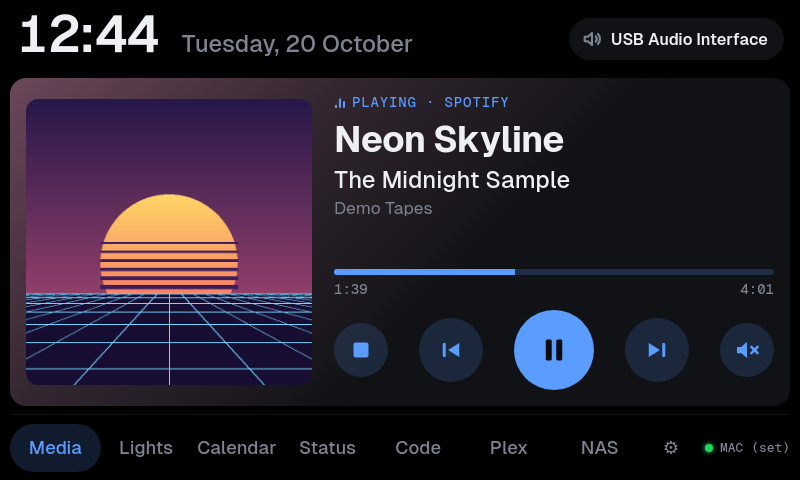 | 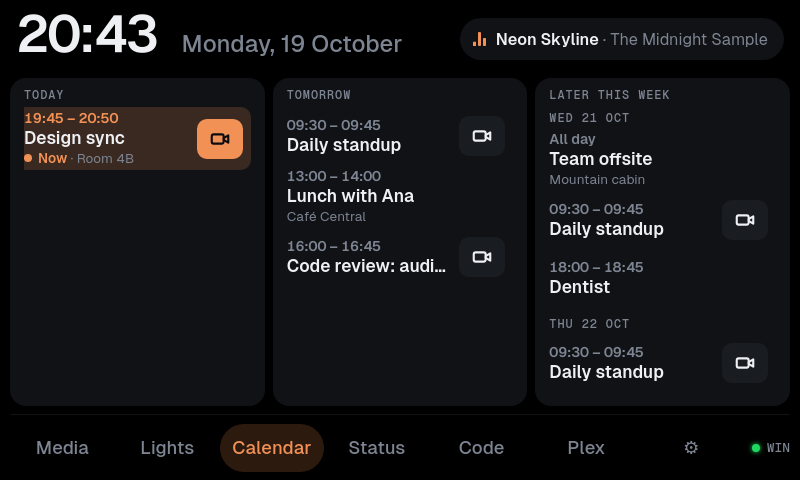 |
| **Media:** what's playing, with controls and the audio output | **Calendar:** the next two weeks; a meeting in progress pulses |
| 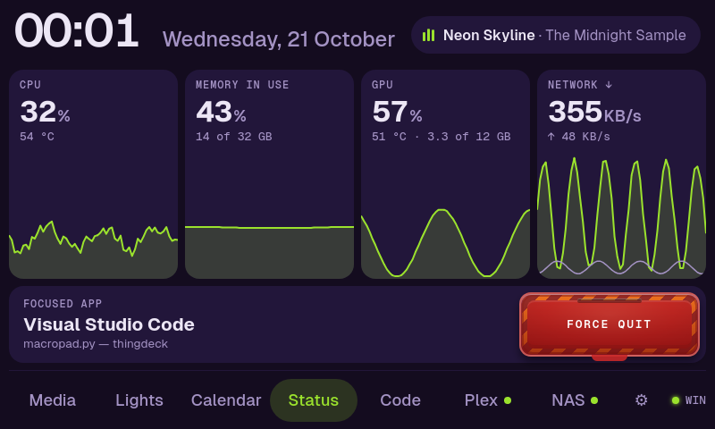 | 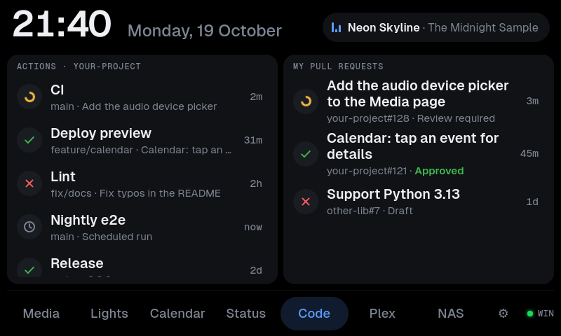 |
| **Status:** live stats and the kill switch | **Code:** GitHub Actions runs and your pull requests |
| 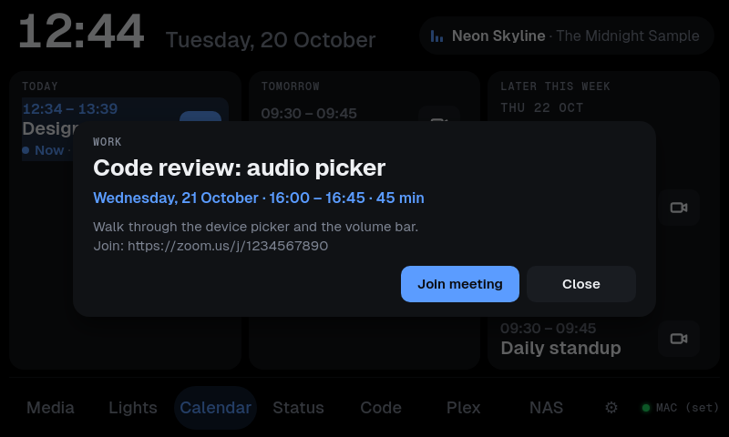 | 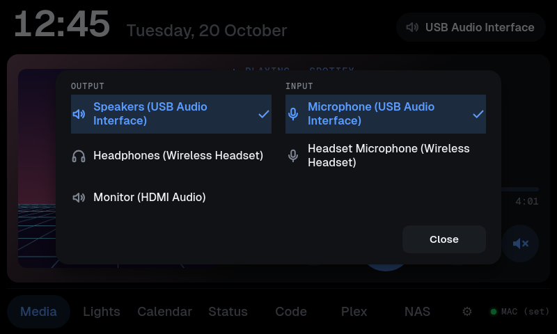 |
| **Event details:** tap any event | **Audio devices:** tap the output in the Media header |
| 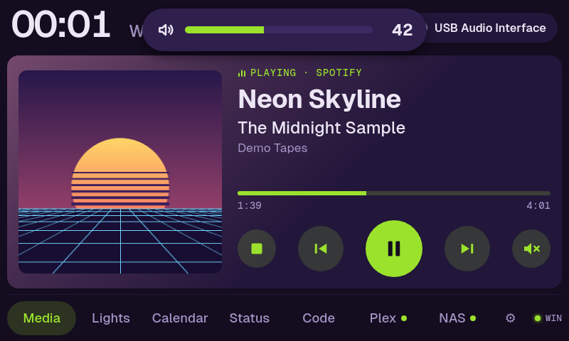 | 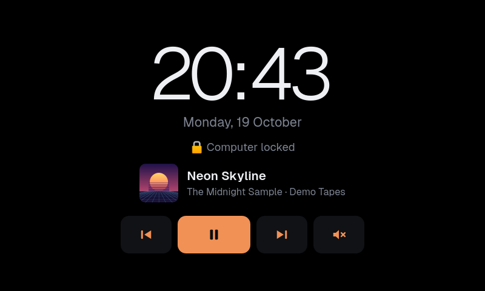 |
| **Volume bar:** shows when the volume changes | **Lock screen:** while the computer is locked |
| 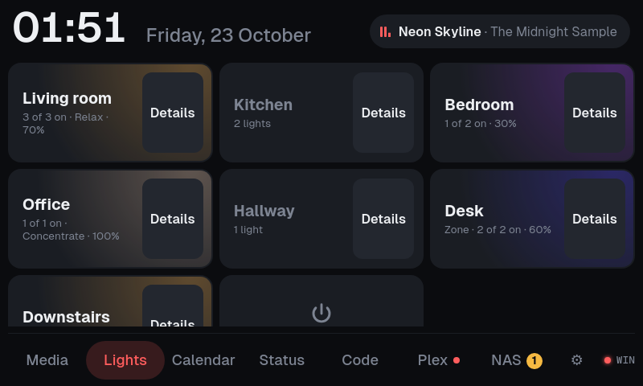 | 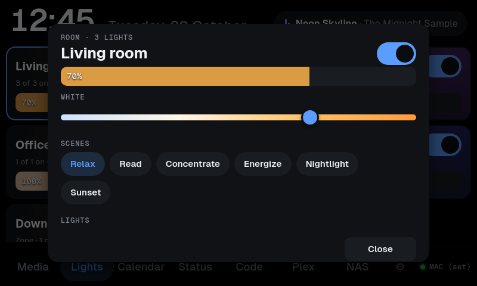 |
| **Lights:** Philips Hue rooms and zones, with the song playing in the top bar | **A room:** brightness, white, scenes, each light |
| 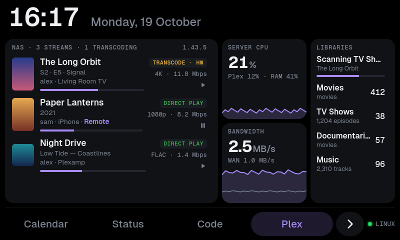 | 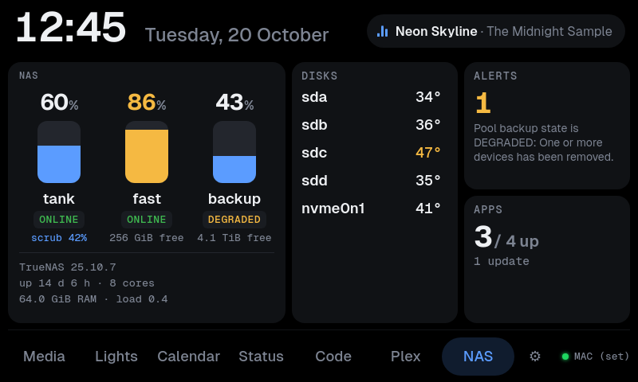 |
| **Plex:** streams and how each is sent, running jobs, server load, libraries | **NAS:** TrueNAS pools, disks, alerts, apps and jobs |
| 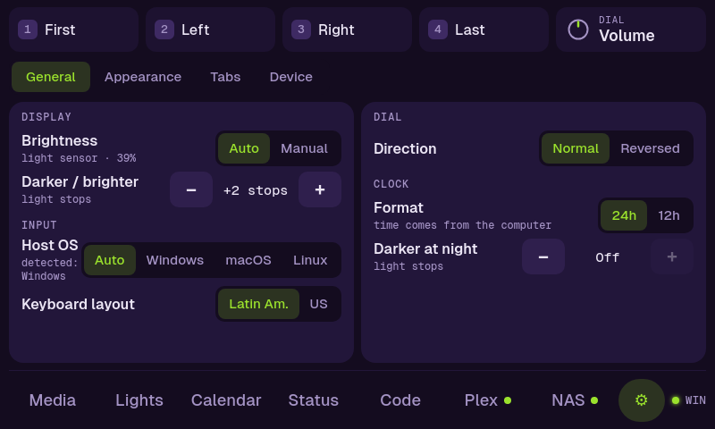 | 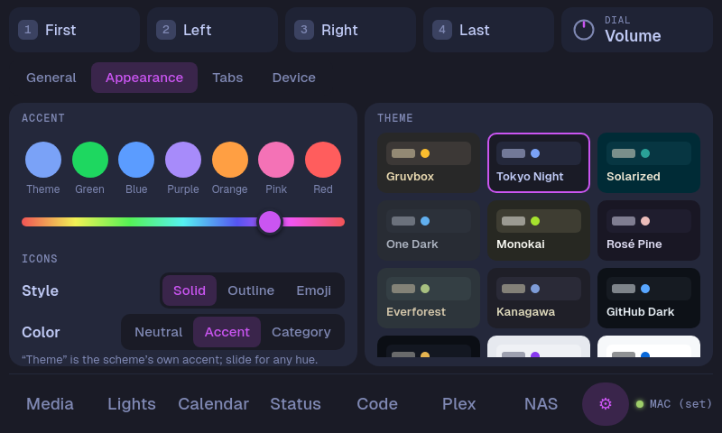 |
| **Settings → General:** brightness, host OS, layout | **Settings → Appearance** |
| 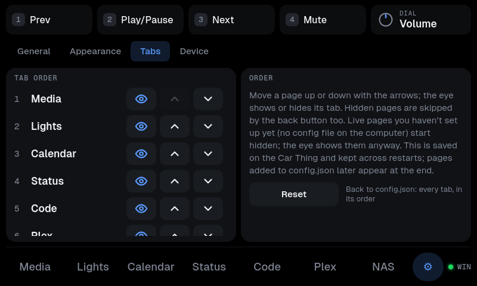 | 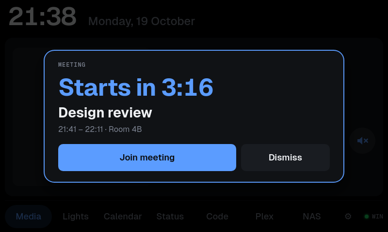 |
| **Settings → Tabs:** the order, and which tabs show | **Reminder:** 5 minutes before an event, on any page |
| 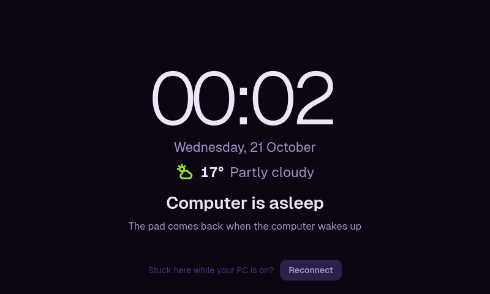 | 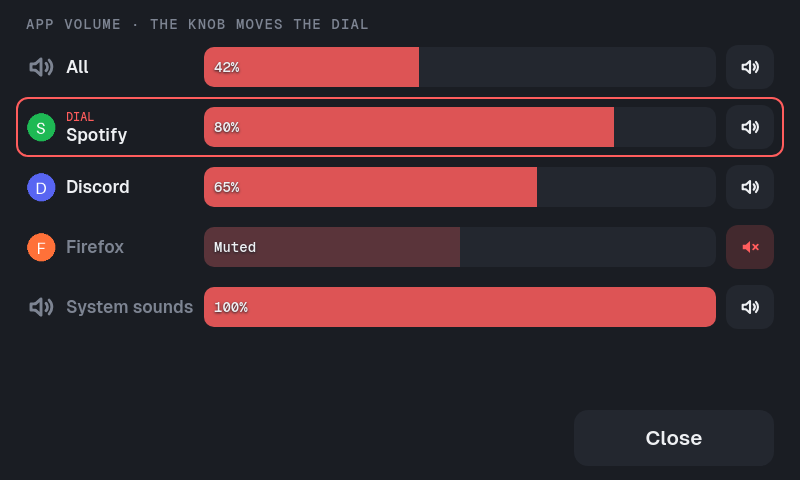 |
| **Standby:** while the computer sleeps | **App volume (Windows, Linux):** each app, and the dial on one |

## Requirements

- A Car Thing running the stock Spotify system with **ADB enabled** (for example
  the "adb enabled" stock image flashed with `superbird-tool`). It must show up in
  `adb devices`.
- `adb` (Android platform-tools) on the computer you deploy from:

  | OS | Install |
  |---|---|
  | macOS | `brew install android-platform-tools` |
  | Fedora | `sudo dnf install android-tools` |
  | Debian / Ubuntu | `sudo apt install adb` |
  | Windows | `winget install Google.PlatformTools` |

- Bash for `deploy.sh`: the built-in one on macOS and Linux, Git Bash on Windows.

Deploying is the only step that needs `adb`. Once installed, the pad works on any
computer without it.

## Install

```bash
./deploy.sh install
```

This checks the Python files and `config.json` on the Car Thing first (a broken
file is refused and nothing changes), then copies `device/` to `/var/macropad`, adds one file,
`/etc/supervisor.d/macropad.conf`, so the pad starts on boot, and reboots. No
stock file is changed. The file goes on **both** system partitions: the
bootloader keeps two copies of the system (slots A and B) and can switch between
them.

| Command | Does |
|---|---|
| `./deploy.sh` | Push the files and restart the service (after editing code), then check |
| `./deploy.sh all` | The same, and reinstall the agent on this computer (after a `git pull`), then check |
| `./deploy.sh check` | Smoke test: the service, the agent's version, each live page's data, and every page drawn without an error; screenshots go to `check-shots/` |
| `./deploy.sh config` | Push only `device/config.json`; the pad reloads it within 2 s |
| `./deploy.sh status` | Show whether the boot hook is on each system slot |
| `./deploy.sh uninstall` | Remove the boot hook and reboot to the stock UI (files stay in `/var/macropad`) |

## Hardware controls

| Control | Default |
|---|---|
| Buttons 1–4 (top edge) | Presets: first page, page left, page right, last page · hold 2: previous track, hold 3: next track |
| Dial turn | Current dial mode (Volume, Lights, Scroll, Zoom, Scrub, Tabs, Undo/Redo) |
| Dial press | Dial mode action (mute, middle click, reset zoom, …) |
| Dial hold | Play/Pause |
| Back button | Next page, wrapping from the last back to the first (from Settings: the first); with a card, notice or reminder open, it closes that instead · hold: first page |
| Menu button (M) | Next dial mode · hold: back to Volume |
| Swipe left/right on the page | Change page |
| Bottom bar | Tap a tab (with more than seven, drag the bar or tap › / ‹ for the rest) |
| Song pill (top bar) | Go to Media |
| Tap the status pill (bottom right) | Cycle host OS: Auto → Windows → macOS → Linux |

All of these can be changed in `device/config.json`.

## Host OS

Shortcuts differ per OS, so any action (a tile, a preset, a dial mode) can carry
`"windows"`, `"mac"` and `"linux"` overrides. The default dial modes use ⌘ on macOS
(zoom, reopen tab, undo/redo).

Over USB, Windows identifies itself, but macOS and Linux look the same. So:

- **Windows:** detected automatically.
- **Linux:** used automatically when the host isn't Windows (`"other_os": "linux"`
  in `config.json`).
- **macOS:** choose **macOS** under Settings → General → Host OS, or by tapping
  the status pill. On a Mac, shortcut hints are shown as ⌃⇧⌥⌘.

The choice is saved on the Car Thing. If you move between a Mac and a Linux
machine, switch it in Settings.


## Keyboard layout

The pad sends key *positions*, so typed text (a tile with `"type"`, for example) has
to match the layout the computer uses. Set it under Settings → General → Keyboard
layout:

- **Latin American:** matches Windows "Latin American" and Linux `latam`.
- **US:** use this on a Mac. macOS's own "Latin American" layout puts symbols in
  different places.

Shortcuts made of letters, digits and named keys work with any layout.

## Computer agent

The pad itself is just a USB keyboard, and computers never send track info, the
time or their lock state to a keyboard. An optional agent on the computer sends
them to the Car Thing **over the USB cable** (`adb forward`; no network):

- **Now playing:** the Media page shows the cover, title, artist, album, the app it
  plays in, playing/paused and a live progress bar, on a card tinted with the cover's
  colors, with round media controls under the progress bar. When nothing is playing
  the card shows a large clock and the date over the controls, which work either way.
- **Calendar:** the Calendar page shows today, tomorrow and the rest of the next two
  weeks (− and + at the top left show 1 to 4 weeks) from your calendars (see [Adding
  your calendar](#adding-your-calendar)): repeating events, moved or cancelled
  occurrences and time zones included, meetings you declined left out. The next event is
  highlighted with a countdown. Events with a Google Meet, Zoom or Teams link get a Join
  button that opens the link on the computer. Tap an event for its details: date, time
  and length, place, calendar and notes. With two calendars or more, tabs at the top
  show **All** or one calendar. The Car Thing keeps the tab you pick, and the number of
  weeks for each tab. If the picked calendar is gone, it shows All. In All, a colored
  dot shows each event's calendar, in the color of its tab. Five minutes before any
  timed event in any calendar, a reminder card comes up on any page with a countdown and
  **Dismiss**, plus **Join meeting** for a meeting with a link or **Details** for
  anything else; it stays until two minutes after the start.
- **Status:** the Status page shows CPU, memory, GPU and network speed, each with
  a graph of the last two minutes. The GPU needs an NVIDIA card (`nvidia-smi`), or
  an AMD one on Linux; CPU temperature shows on Linux.
- **Kill switch:** below the stats, the Status page shows the app that has focus on
  the computer, next to a covered switch like an aircraft's. Tap the cover to lift
  it; once "KILL" lights up (about a second later), press it to force-quit that app.
  The cover closes again after 6 seconds. Only the app shown is killed, and only if
  it still has focus. The system and desktop shell (Explorer, the window manager,
  Finder, the Dock, …) and the agent itself are protected. Finding the focused app:
  - Windows: the foreground window; apps running as administrator can't be killed
    unless the agent runs as administrator too.
  - macOS: the frontmost app (`lsappinfo`, no permission prompts).
  - Linux: X11 (`xprop`), Hyprland, Sway, KDE Wayland with `kdotool`, and GNOME
    Wayland with the [Window Calls](https://extensions.gnome.org/extension/4724/window-calls/)
    extension, since GNOME doesn't share the focused window otherwise.
- **Lights (Philips Hue):** a card per room and zone, tinted with the color its lights
  show (an off room's name dims), with how many lights are on, the scene and the
  brightness. Tap a card to turn the room on or off; **Details**, the right third of
  the card, opens it full screen: its brightness bar (tap or drag), scenes, a
  warm-to-cool white slider and each light's bar, which turns that light off at its
  left end. Tapping a room also makes it the
  target of the dial's **Lights** mode (turn: brightness, press: on/off, with a bar on
  screen like the volume one). "All off" turns every room off. See
  [Connecting Philips Hue](#connecting-philips-hue).
- **Code (GitHub):** the latest run of each workflow in one repository (up to 20:
  running, queued, passed, failed or cancelled, with branch, commit and time) and your
  open pull requests on any repository, with their checks, review state and draft flag.
  Both lists scroll. Tap a row for a card with its details and its link. For a workflow
  run, the card shows its number, who started it and the commit, how long it runs, and
  each job with its state, the step it runs or the step that failed, and its time; for a
  pull request, its branches, author and size, whether it can merge, who reviewed it and
  who still has to, and each check with its state and time, failing and running ones
  first. While a run or a check goes on, the card updates every 5 seconds. **Open on
  computer** opens the run or pull request in the browser there. When a workflow run
  starts while another page is on screen, a small card shows it, with **Go to Code**; it
  closes by itself after 20 seconds. It refreshes every minute, or every 15 seconds
  while a workflow runs; pull down on either list to fetch it right away (see [Adding
  GitHub](#adding-github)).
- **Plex:** the streams on your Plex Media Server, and a dot on the Plex tab while
  someone streams. Each stream shows its poster, the user and player, the progress and
  the quality; tap it for a card with more: the player and its network, the media
  (container, codecs, resolution, channels, bitrate), the audio and subtitle tracks, and
  for a transcode, what changes, its speed, and whether the hardware does it. When a new
  stream starts while another page is on screen, a small card shows it, with **Go to
  Plex**; it closes by itself after 20 seconds (off the Plex page, the agent reads Plex
  every 30 seconds, so the card can come that much later). A tag shows how the server
  sends it: direct play, direct stream, or transcode (HW for a hardware transcode).
  Under the streams are the jobs that run now, with their progress: library scans and
  the scheduled tasks (Settings → Scheduled Tasks in Plex). Next to the streams are
  graphs of the server's CPU and bandwidth, and the size of each library. The graphs
  need Plex Pass. The page refreshes every 3 seconds while it's on screen, every 30
  seconds otherwise (see [Connecting Plex](#connecting-plex)).
- **NAS (TrueNAS):** a dot on the NAS tab, in the accent color while the server answers
  and red when it fails, or a badge in the warning color with the number of updates
  waiting (apps, and a newer TrueNAS); each pool as a tank that fills up (yellow from
  80%, red from 90%) with its health, free space and size, the temperature of every disk
  (NVMe drives have their own, higher limits), the server's alerts, how many apps run
  and which have updates (in the warning color), and the jobs that run now (a scrub, a
  snapshot, replication or cloud sync task, an app update), with the first one's
  progress. When no job runs, it shows the next scheduled task and when it runs (a scrub
  waits for its threshold). Below the disks: the TrueNAS version (and a newer one when
  it is out, in the warning color), uptime, load, cores and memory. It refreshes every
  10 seconds while on screen, every minute otherwise (see [Connecting
  TrueNAS](#connecting-truenas)).
- **Volume and audio devices:** when the volume or mute changes (the dial, the Mute
  tile, your keyboard), a volume bar shows at the top for a moment. The Media page
  header shows the current output; tap it to pick the output and input devices.
  - Windows: Core Audio, the same switch the Sound settings use (all roles, so calls
    move too).
  - Linux: `pactl` (PipeWire or PulseAudio).
  - macOS: the volume always; switching devices needs `brew install switchaudio-osx`.
- **App volume (Windows, Linux):** like the Volume Mixer or a Stream Deck volume dial. The
  mixer button next to the output on the Media page opens it, full screen: **All** (the
  system volume) and each app playing through the output, with its icon, a bar to drag and
  a mute button. In the **Volume** dial mode the dial turns the one marked *Dial*, All at
  first, and pressing the knob moves it on to each app in the list and back to All
  (tapping a name picks one too). The knob opens the mixer over whatever page you're on,
  and it closes again a few seconds after the dial's last use; closing it puts the dial
  back on All, so outside the mixer the dial is always the system volume. On macOS (it
  has no per-app volume), or without the agent, the knob mutes as before.
  - Windows: each app's audio sessions on the default output, as the Volume Mixer shows them.
  - Linux: each app's PipeWire or PulseAudio streams, through `pactl`; the icons come from
    the icon theme, and an app with only an SVG icon needs `rsvg-convert` (`librsvg2-tools`
    on Fedora, `librsvg2-bin` on Debian and Ubuntu).
- **Clock:** the agent sets the Car Thing's clock and time zone (DST included).
  The time shows large with the date at the top of the live pages (Media, Lights,
  Calendar, Status, Code, Plex, NAS), and on the standby and lock
  screens; 24h/12h is under Settings → General → Clock.
- **Weather:** under the large clocks (Media with nothing playing, the lock and
  standby screens): the temperature and the sky with its icon (sun or moon by the
  time of day); while something plays, the Media page's top bar shows the icon and
  temperature next to the date. From [Open-Meteo](https://open-meteo.com) every 15
  minutes (see [Adding the weather](#adding-the-weather)).
- **Lock screen:** while the computer is locked, the Car Thing shows the clock,
  "🔒 Computer locked", the cover and what's playing, and media buttons. Tiles,
  presets and dial modes that press keys are blocked while locked, so nothing gets
  typed into the password box; media keys, volume and the wheel still work.

The agent works hardest for the page on screen: Lights, Status (its GPU reading), Code,
Plex and NAS update every few seconds while you look at them and slowly otherwise (every
30 seconds; GitHub and NAS every minute), and opening one of them fetches
its data right away. The calendars are read every 5 minutes, and every minute while the
Calendar page is on screen or an event starts within 15 minutes. What the other screens
need (the song, volume, lock state) keeps its usual pace. When the Car Thing reconnects
(after a restart, an unplug or sleep), the agent sends everything again at once.

Install it once per computer (and once per OS on a dual-boot PC). It starts at
login, survives unplugging and sleep, and needs `adb` (see [Requirements](#requirements)):

| OS | Now playing from | Install |
|---|---|---|
| Windows | The system media session (Spotify, browsers, Media Player, …) | `powershell -ExecutionPolicy Bypass -File host\windows\install.ps1` |
| Linux | MPRIS through `playerctl` (Spotify, browsers, VLC, …) | `host/unix/install.sh` |
| macOS | `media-control` or `nowplaying-cli` (Spotify, browsers, Music, …), or Spotify and Music through AppleScript | `host/unix/install.sh` |

- **Windows:** a Task Scheduler task at logon starts a tiny windowless launcher
  in `%USERPROFILE%\.thingdeck`. Log: `%USERPROFILE%\.thingdeck\nowplaying.log` (past
  256 KB the older part moves to `nowplaying.log.1`).
- **Linux:** a systemd user service (`thingdeck-agent`). Needs `playerctl`
  (`sudo dnf install playerctl`). Log: `journalctl --user -u thingdeck-agent`.
- **macOS:** a LaunchAgent. `brew install media-control` is recommended: it works on
  recent macOS and keeps the progress bar right for browsers. Without it the agent
  uses `nowplaying-cli`, and where macOS restricts that, asks Spotify or Music
  directly (macOS asks once to allow that). When the player gives macOS no cover
  (Firefox, for example), the agent looks the album up in Apple's iTunes Search API,
  which is sent the artist and album name. Lights, Plex and NAS also need
  **Local Network** access: turn on Python under System Settings → Privacy &
  Security → Local Network. Without it, the agent's requests to the bridge and
  the servers fail with "No route to host". Log:
  `~/Library/Application Support/thingdeck/nowplaying.log` (past 256 KB the older
  part moves to `nowplaying.log.1`).

Uninstall with `install.ps1 -Uninstall` or `install.sh --uninstall`. To check what
the agent sees without installing: `nowplaying.ps1 -Once` or `nowplaying.py --once`.

### Adding your calendar

The agent reads calendars from their private iCal address, so it needs no sign-in:

1. In Google Calendar on the web, open Settings, pick your calendar under
   "Settings for my calendars", and copy **Secret address in iCal format** from
   "Integrate calendar".
2. Put it on its own line in `calendars.txt` (create the file):
   - Windows: `%USERPROFILE%\.thingdeck\calendars.txt`
   - Linux: `~/.config/thingdeck/calendars.txt`
   - macOS: `~/Library/Application Support/thingdeck/calendars.txt`

   Add one line per calendar. Any iCal address works (Outlook's published calendars
   too); lines starting with `#` are ignored.
3. The agent downloads the calendars every 5 minutes (every minute while the Calendar
   page is open or an event is near), so they show up within 5 minutes; no restart
   needed. Google itself can take a few minutes to publish a change to the address.

The secret address lets anyone who has it read that calendar, so keep the file to
yourself; if it leaks, reset it on the same Google Calendar settings page. Work
accounts may have it turned off by an administrator.

### Adding GitHub

The agent asks GitHub through the [GitHub CLI](https://cli.github.com), which keeps
your sign-in; no token is stored by thingdeck.

1. Install it and sign in once:
   - Windows: `winget install GitHub.cli`
   - Fedora: `sudo dnf install gh`
   - macOS: `brew install gh`

   Then run `gh auth login`.
2. Put the repository for the Code page in `github.txt`, next to `calendars.txt`:
   its name if it is one of yours (`my-repo`), or `owner/name`. Lines starting with
   `#` are ignored.

The file stays on your computer, so the repository's name is never in this repo.
Your open pull requests come from any repository; the Actions card shows that one.

### Connecting Philips Hue

The Car Thing has no network of its own, so the agent talks to your Hue Bridge on
the local network, using the bridge's own API (no Hue account or cloud involved).

1. Open the **Lights** page and tap **Pair**.
2. Within 30 seconds, press the round button on top of the Hue Bridge.

The agent finds the bridge (through Philips' discovery service), gets a key, and
saves both in `hue.json` next to `calendars.txt`. Your rooms show up a moment later.
To pair again, delete `hue.json` and tap Pair. Light changes made elsewhere (the
Hue app, a switch) show on the Car Thing within about a second while Lights is on screen. Lights only work
while the computer is on and the agent is running, and they need a Hue Bridge;
lights used only through Bluetooth can't be reached.

### Connecting Plex

The Car Thing has no network of its own, so the agent reads your Plex Media Server
on the local network. It uses the server's own API, not the Plex cloud.

1. Find the local address of the server. In Plex Web, open Settings → Remote Access.
   The page shows the private address, for example `192.168.1.20:32400`.
2. Put the address on the first line of `plex.txt`, next to `calendars.txt`. If the
   line has no port, the agent uses 32400.
3. If the Plex page shows "The server asks for a Plex token", put your token on the
   second line of `plex.txt`. Plex's article
   [Finding an authentication token](https://support.plex.tv/articles/204059436-finding-an-authentication-token-x-plex-token/)
   shows where to find it.

By default, a Plex server asks for a token, also on the local network. A server
that lists your network under Settings → Network → "List of IP addresses and
networks that are allowed without auth" does not ask for one. The agent reads
`plex.txt` on each refresh, so a change shows within seconds and needs no restart.

The token gives access to your Plex account, so keep `plex.txt` to yourself. The
graphs of CPU and bandwidth need Plex Pass. Without it, the page shows the streams and
libraries only.

### Connecting TrueNAS

The agent reads your TrueNAS server on the local network through its own API, with an
API key. It needs TrueNAS 25.04 or later (the WebSocket API).

1. Open the TrueNAS web interface (for example `https://192.168.1.30`) and sign in.
2. Click the **person icon** at the top right, then **My API Keys**. (If it isn't
   there, use **Credentials → API Keys** in the sidebar.)
3. Click **Add**, name it `thingdeck`, leave **Non-expiring** on, and **Save**.
4. TrueNAS shows the key **only once**: copy it.
5. Create `truenas.txt` next to `calendars.txt` with the server's address on the
   first line and the key on the second:

   ```
   192.168.1.30
   1-AbCdEf…
   ```

The NAS page shows up within a minute; no restart needed. The agent always connects over
HTTPS: TrueNAS revokes a key that is ever sent over plain HTTP. It accepts the server's
self-signed certificate for that address only. The agent only reads (system info, pools,
disk temperatures, alerts, apps, running jobs). The key carries the rights of the user
who made it, so for read-only access, make it as a user in the read-only administrators
group. Keep `truenas.txt` to yourself.

### Adding the weather

Put your place on the first line of `weather.txt`, next to `calendars.txt`: a city
(`Paris`), a city and its country when the name is common (`Paris, France`), or
`latitude, longitude` (`48.85, 2.35`). For °F, add a second line `fahrenheit`.
Lines starting with `#` are ignored.

The agent asks [Open-Meteo](https://open-meteo.com) every 15 minutes; it needs no
account or key. A name is looked up once with Open-Meteo's geocoder. The place you
put there is sent to Open-Meteo, so use coordinates of your town rather than your
street if that matters to you. The weather shows within 15 minutes, or at once after
the agent restarts.

## When the computer sleeps

When the computer sleeps or shuts down and the Car Thing still has power, the
screen shows **Computer is asleep**, dims to its minimum brightness, and the
buttons do nothing. Your brightness setting comes back with the computer. When the computer
wakes up, the Car Thing reconnects by itself within a few seconds.

**The Car Thing cannot wake or turn on the computer.** Waking over USB was tried,
and the hardware can't do it. Details are in
[device/README.md](device/README.md#standby-resume-and-reconnect). Use the
computer's own keyboard or power button.

If it ever stays on the standby screen while the computer is on, tap **Reconnect**
at the bottom of that screen (or Settings → Device → Reconnect USB). That
detaches and reattaches USB, like pulling the cable. If the computer still hasn't
picked it up after 20 seconds, the Car Thing reboots.

## Customizing

Edit `device/config.json` and run `./deploy.sh config`. To add a page of tiles, add
`{ "name": "Shortcuts", "tiles": [...] }` to `pages` (up to 8 tiles show at once,
in a 4×2 grid). A tile looks like:

```json
{ "label": "Snip", "symbol": "snip", "key": "win+shift+s",
  "mac": { "key": "cmd+shift+4" }, "linux": { "key": "printscreen" } }
```

`symbol` picks a built-in icon that follows the icon style and color settings; an
emoji in `"icon"` works too.

The full action reference (keys, media, typed text, sequences, wheel, page/dial
switching, per-OS overrides) is in [device/README.md](device/README.md#configjson).

## Recovery

- If the service crashes, the USB device falls back to plain ADB, so you can
  always reach the Car Thing again.
- **Safe mode:** hold the back button while the Car Thing boots. The pad then
  leaves USB as ADB only.
- **Stock UI came back by itself?** The bootloader switched system slots. Run
  `./deploy.sh status`, then `./deploy.sh install`.
- `./deploy.sh uninstall` removes the boot hook and restores the stock UI.

## Known limitations


- **Hue, Plex and TrueNAS go through the computer:** with the computer off or asleep,
  the Lights, Plex and NAS pages cannot reach the bridge or the servers.
- **The live pages, the clock and the lock screen need the agent** on each
  computer. Without it, there's no clock, the Media page shows its controls and a hint, and
  Calendar, Status, Code, Plex and NAS say the agent is missing. The macOS agent is tested on
  an Apple Silicon Mac (macOS 27); the Linux agent is untested on real machines so far.
- **No Windows CPU temperature:** Windows only gives it to programs running as
  administrator with a hardware driver, so the Status page leaves it out there.

## License

[PolyForm Noncommercial 1.0.0](LICENSE). In short:

- **Allowed:** using, changing and sharing thingdeck for personal, hobby, research
  or educational use, and by non-profits, schools and public bodies.
- **Not allowed:** any commercial use, or use by a business.
- **Credit:** every copy, changed or not, must include the license and its
  `Required Notice:` line, which credits Leonardo Godoy and links to this repository.

For commercial use, ask the author. Versions published before the license changed
were under GPL-3.0, and those copies keep that license.
